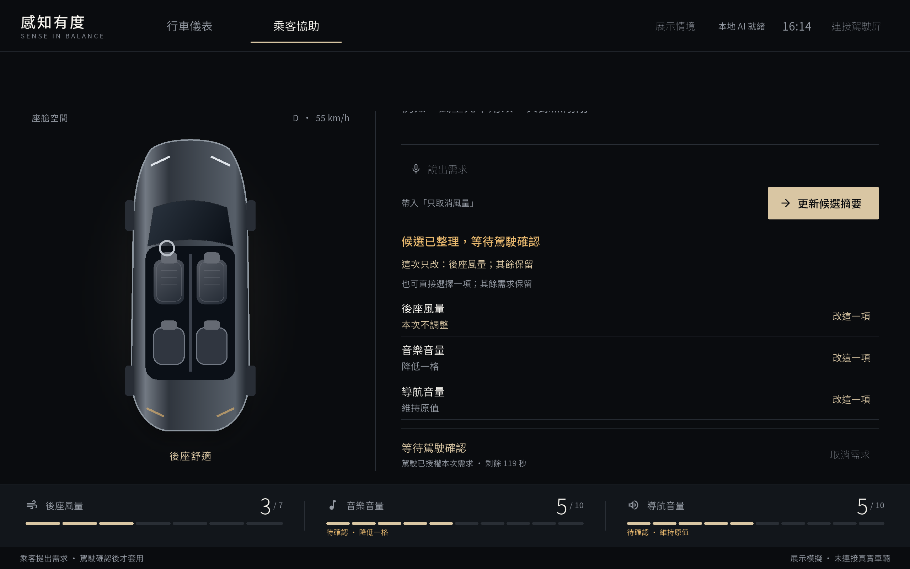
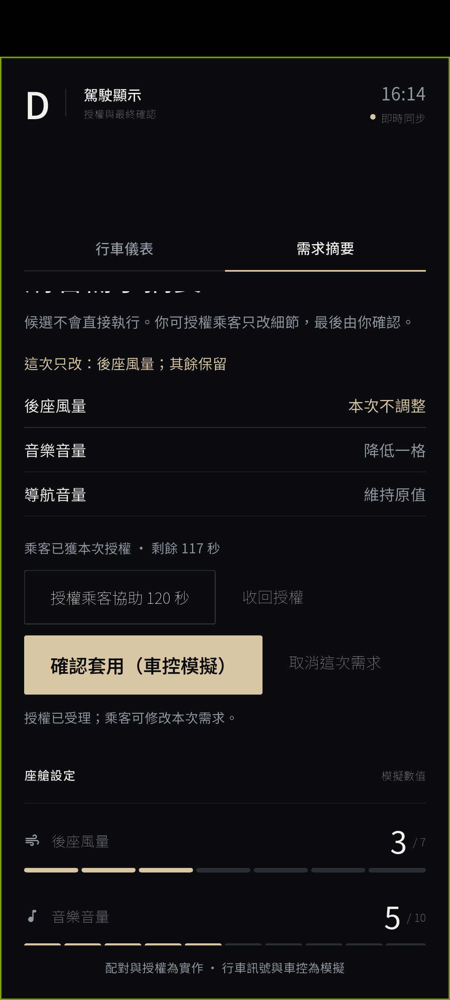
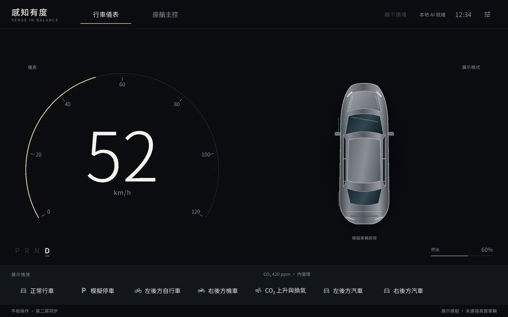
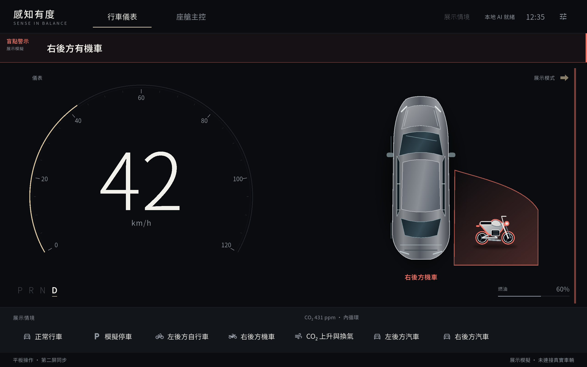
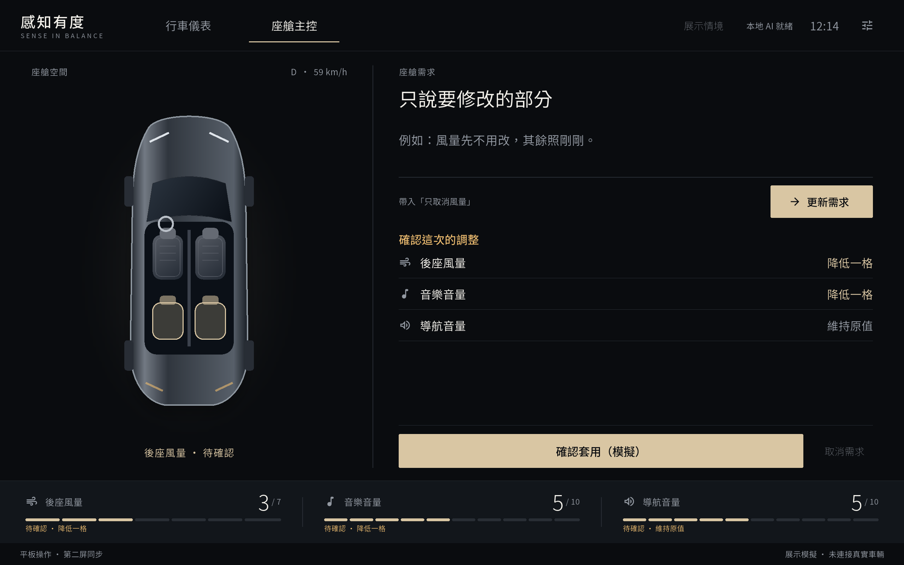

# 感知有度｜智慧座艙雙屏原型

保留原作的「該說才說」規則警示，加入「不用重講」座艙任務修復：**乘客提出候選，駕駛配對並授權，乘客只改出錯項，駕駛確認最新版本，收到逐項回執後才顯示完成。** 一台平板作乘客詳細端與本地狀態主機，另一個螢幕作駕駛端；本次 **Qwen2.5-1.5B-Instruct** 在 PC 本地執行。車速、盲點與車控均為模擬。

本倉庫是 [Kinoko1412/sense-in-balance](https://github.com/Kinoko1412/sense-in-balance) 的公開 fork，從 `5ea2253` 延伸，保留原始 Git 歷史。原作團隊：**葉士愷・黃昱羲・胡馨**。原始提案、研究及 App 仍在倉庫；[原 README](docs/ORIGINAL_README.md) 另存，方便對照。

## 畫面與功能

最新兩個target 34 APK已在原生Android模擬器走完：乘客真Qwen提出三項候選 → 駕駛配對／授權 → 乘客真Qwen提交「風量先不用改，其餘照剛剛。」 → 駕駛確認最新版本 → 逐項模擬回執、兩屏3／4／5。這次是文字局部改口／取消，沒有人工注入錯誤或按鈕修導航；模型提出修正，規則與權限仍負責驗證、確認和執行。沒有測麥克風。

| 乘客看明細、修正候選 | 駕駛看摘要、決定是否套用 |
|---|---|
|  |  |

[駕駛完成畫面：逐項回執與3／4／5](docs/evidence/native/repair-driver-final.png)、[兩次真Qwen raw／trace](docs/evidence/native/repair-final-qwen-traces.txt)、[完成狀態JSON](docs/evidence/native/repair-final-status.json)。這是模擬車控的原生互動證據，不是自然模型錯誤率或人體效益量測。

先前target 36的安排誤解展示另保留：[乘客文字＋按鈕修正](docs/evidence/native/repair-passenger-revised.png)、[駕駛摘要](docs/evidence/native/repair-driver-revised.png)、[完成回執](docs/evidence/native/repair-driver-complete.png)。該次人工導航誤解有明示來源，也觀察到120秒授權到期禁止編輯、重新授權恢復；不能冒充最新流程的自然誤判。

以下保留原生行車警示與早期需求畫面：



| 行車警示 | 座艙需求協作 |
|---|---|
|  |  |
| 警示區固定占位，不會擠壓或縮放儀表；左右汽車、機車、自行車以不同輪廓顯示。 | 此圖保留早期版面；新版加入駕駛配對、任務授權、乘客逐項修改與駕駛確認。最新角色畫面另附於驗證文件。 |

- **安全警示直接發出**：盲點與原規則不等模型；兩屏共用事件的側別、文字與物件。
- **不用整段重講**：Qwen 提出後座風量、媒體音量、導航音量的有限修正；規則保留其餘待執行項、處理明確取消與必要澄清。一般示範輸入仍真跑 Qwen，「帶入示範需求」只填文字；明確含糊／不支援輸入可先由規則澄清，逐項按鈕則不呼叫模型。
- **雙屏各司其職**：乘客看明細、經本次任務授權後修正；駕駛看短摘要，透過六位碼配對後才可授權／收權、確認或取消。未配對第二屏只有觀察權；執行中不能重送，舊版本、授權逾時與斷線會阻擋操作，完成來自逐項 ACK。按鈕修其他項不會抹掉未回答的澄清，仍有問題就禁止確認。
- **安排誤解有標示**：桌面展示可手動把尚未執行的導航候選改錯，畫面標明「展示安排的誤解，尚未執行」，結果保留來源；不是模型自然錯誤率，也不會因此授權或執行。
- **Android 語音入口已實作，真機仍未測**：只使用 Android on-device ASR；沒有可用服務／中文模型時回到文字，不偷偷改用雲端辨識。尚未量測 S9 麥克風、口音、ASR 或斷外網兩實體平板全流程。
- **原作仍可獨立開啟**：地圖、知識庫問答、語音、原情境劇本和角色選擇保留於原入口，尚未全部遷入新版。

## 先在電腦操作

準備 **Flutter 3.35.2、JDK 17、Android SDK**；Windows雙裝置展示另需Android Emulator、兩個API34 x86_64 AVD，以及本機Qwen GGUF／llama.cpp Vulkan runtime。最新建置設定為 **compile SDK 36、target SDK 34、min SDK 24**；最終兩APK已重建、aapt核對、安裝並完成上方全流程，符合V11這一項target建置要求。這仍不等於S9、語音或全部交件項已驗證。

在英文路徑 clone，依 [Windows 雙裝置指南](docs/WINDOWS_DESKTOP.md) 準備模型和 AVD，再於倉庫根目錄執行：

```powershell
powershell.exe -NoProfile -ExecutionPolicy Bypass -File .\tools\desktop\build-demo.ps1
.\tools\desktop\start-demo.cmd
```

APK、模型、runtime 和 log 存於被 Git 忽略的 `.local/`；本倉庫只提供原始碼、截圖與工具，不包含預建 APK 或模型。設定外部檔案路徑、首次建置與同步連線，見上述指南。

## 開發入口

| Dart 入口 | 用途 |
|---|---|
| `lib/main.dart` | 原作完整 App、角色選擇 |
| `lib/main_repair.dart` | 乘客詳細端／狀態主機：儀表＋候選＋授權後局部修正 |
| `lib/main_repair_monitor.dart` | 原生駕駛端：未配對觀察，配對後授權／確認／ACK |
| `lib/main_repair_web.dart` | 選用瀏覽器駕駛端，使用同一配對與權限流程 |

檔案位於 `app/cockpit_hmi/`。建置參數、實體兩平板連線、測試方式見 [DEVELOPMENT.md](docs/DEVELOPMENT.md)；實測證據與限制見 [VALIDATION.md](docs/VALIDATION.md)。

## 驗證與邊界

最終完整工程測試 **88/88 通過**，靜態分析無問題；涵蓋按鈕修改保留未回答澄清、駕駛確認受阻、回答後僅執行一次的回歸。固定公開20例歷史未保護解析13/20，挑戰修正後保護鏈路重跑20/20，其中 **14例真 Qwen 生成＋6例確定性澄清**。題目已看過並據此改規則，這不是獨立未見測試，也不是 SLM 獨力100%正確。新增開發者16例挑戰首次 **10/16**（12真Qwen＋4規則），最小修正後同批已見回歸 **12/16**（10真Qwen＋6規則）；仍有額外keep、集合取消／全撤回和多餘澄清等4項契約缺口。保留首次失敗，不能把20/20泛化到新說法。

修正前四條件機器回放驗證局部修正、兩個WebSocket客戶端與逐項模擬回執，沒有受試者；B/C原始取消誤解由規則校正，raw保留。[最終工程與原生驗證（含source／APK SHA）](docs/evidence/final-validation.json)、[逐題證據與限制](docs/VALIDATION.md)、[完整研究與測試計畫](docs/REPAIR_EVIDENCE_AND_TEST_PLAN.md)。

隊友審查簡報：[方案01的完整補齊與驗證](docs/repair-proposal.pdf)（12頁）。新版角色與原生警示、早期互動截圖均保留，方便隊友核對實作與沿革。

這不是實車 ADAS 或自動駕駛系統：沒有 CAN 或攝影機偵測，車控是替身。ASR橋接的程式存在不等於語音真機驗證完成；PC GGUF、Android模擬器與機器回放不代表 Samsung S9 端上 LiteRT 的速度／相容性，也不證明車主高頻需求、操作負擔或安全效益。原研究的12,000組規則基準與約70%保持安靜是上游研究結果，不是新版模型準確率。

## 原作與授權

保留 `research/`、`app/slm_probe/`、`media/` 和既有第三方授權資料。新 UI 包含 Noto Sans TC 字型及 [SIL OFL 授權](app/cockpit_hmi/assets/fonts/OFL.txt)。Qwen、Flutter、各套件及圖資遵循各自授權；模型來源請用指南中的官方連結。

原倉庫沒有頂層專案 `LICENSE`，本 fork 沒有擅自新增整體授權。對外授權及商用範圍需由團隊共同確認。
