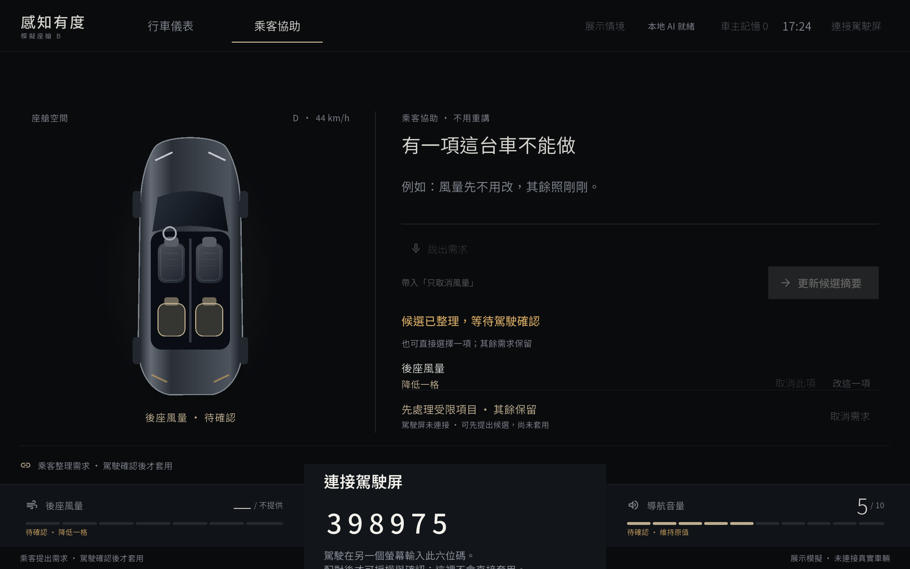
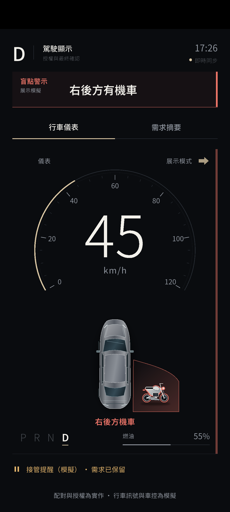
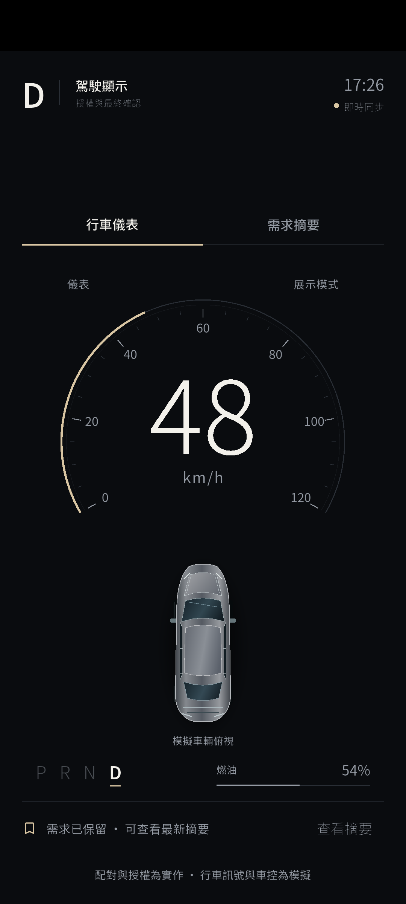
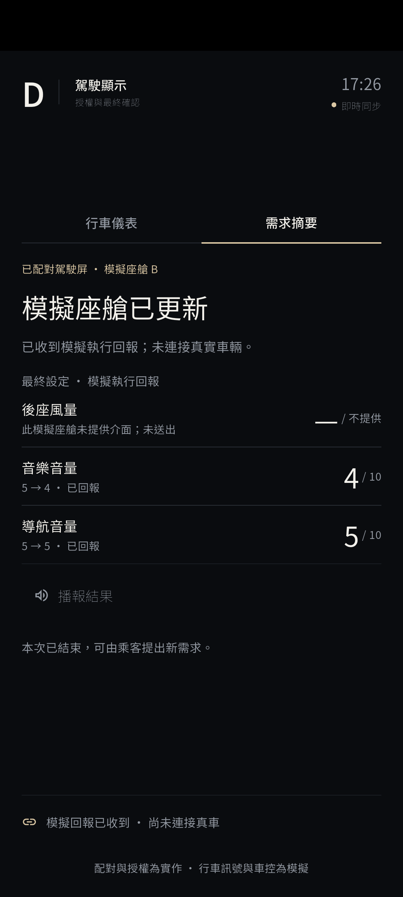

# 感知有度 C｜給隊友的完整交接

這版把「不用重講」延伸成**注意力模式與跨車型任務協調**：保留需求，核對本車能力，在警示期間暫停確認，解除後由駕駛明確確認最新版。兩份車型設定、行車事件與車控都是模擬。

- [下載完整版本與模型](https://github.com/1qaz0726-star/sense-in-balance/releases/tag/v1.2.0-cabin-c-demo-20261017)
- [17 頁團隊簡報](cabin-c-team-brief-20261017.pdf)
- [C 原始碼分支](https://github.com/1qaz0726-star/sense-in-balance/tree/codex/c-attention-coordination)
- [相對同學 Hybrid 分支的修改](https://github.com/1qaz0726-star/sense-in-balance/compare/shikai/hybrid-cloud...codex/c-attention-coordination)
- [完整實作說明](../../C_COORDINATION.md)／[修改前的設計定稿](../../C_IMPLEMENTATION_DESIGN.md)

原始實作驗收提交為 `6309c9c1a15553ff065d339fb5e92af7e93c59c0`；本次三個 APK 的 App 程式來源為 `010a0a4`，之後是桌面啟動器、文件與發布資料整理。原作、同學分支與 Hybrid V3 基準均保留，沒有要求覆蓋 `main`。

## 先下載什麼

以下檔案位於上方 GitHub Release。模型與 APK 放 Release 下載區，不塞進 Git 歷史。`SHA256SUMS.txt` 是本次 Release 下載檔的核對表；support ZIP 內原有的同名檔則核對舊本機交付包，兩者涵蓋範圍不同。

| 檔名 | 用途 |
|---|---|
| `cabin-c-native-arm64-x64.apk` | S9 等 arm64 Android 的本地主機；也包含 x64 供原生模擬器測試。模型另外匯入。 |
| `cabin-c-driver-arm64-x64.apk` | 駕駛第二屏。這個預建檔內建模擬器位址；實體手機須用 S9 區網 IP 重建。 |
| `cabin-c-pc-x64.apk` | 電腦雙屏方案的平板模擬器主機，只供 x64 模擬器，使用電腦上的模型服務。 |
| `cabin-v3-clean-q8-c2048.litertlm` | Android V3 模型，1,823,647,040 bytes；配合下列 manifest 匯入。 |
| `cabin-v3-manifest.json` | Android 模型的身分、大小與 SHA-256；不必手動修改。 |
| `cabin-v3-clean-hybrid-q8_0.gguf` | 電腦 V3 模型，1,646,573,152 bytes；不能拿 `.litertlm` 替代。 |
| `cabin-v3-gguf-export-manifest.json` | PC GGUF 的匯出來源與雜湊紀錄，搭配模型說明查核。 |
| `cabin-c-team-brief-20261017.pdf` | 與本頁所附完全相同的 17 頁團隊簡報。 |
| `cabin-c-supporting-files-20261017.zip` | 本機交付包的其餘資料：完整證據、文件、歷史模型卡、授權、程式 ZIP 與 C patch；3 個 APK 和 Android 模型另列下載。 |
| `SHA256SUMS.txt` | Release 檔案雜湊。下載後先核對，避免不完整模型或錯版 APK。 |

GitHub 的 Source code ZIP 只含已追蹤程式與文件；不包含以上大型二進位檔、Flutter／Android SDK 或本機 runtime。

三個 APK 都使用獨立 C 套件 `com.auohack.cockpit_hmi.coordination`、版本 `1.2.0+2026101702`，按角色裝到不同裝置；在同一裝置換角色會取代該裝置的 C App。原作與 Hybrid V3 使用其他套件名稱。若 Android 因既有簽章不同拒絕升級，先保留資料並處理簽章，別藉卸載原作解決。

## 用 S9 與手機展示

1. S9 安裝 Native APK。在模型設定匯入 `cabin-v3-manifest.json` 與 `cabin-v3-clean-q8-c2048.litertlm`，選 V3 槽，等待實際載入與暖機。manifest 依模型內容核對，不靠檔名假定匯入成功。
2. S9 與手機連到同一區網，取得 S9 真正的區網 IP。依下方建置範例重建 Driver，把 `DeviceUrl` 改成 `ws://<S9區網IP>:8767/repair`，再安裝到手機。預建 Driver 的 `10.0.2.2` 是模擬器回連電腦用位址，不適用實體手機。
3. 平板開「連接駕駛屏」，手機輸入六位碼。先檢查兩屏連線、來源新鮮度與模型候選，再照下方 B 展示流程操作。

**S9 與實體手機尚未連接驗證。** 原生 Android 14 x86 模擬器首啟暖機失敗；正常重開一次後 CPU 載入成功，一筆真模型候選耗時 33.75 秒。只驗證 A 候選與注意力保留／解除，沒有驗過原生版完整 A/B 雙屏車控。不能把重試成功或 x86 耗時當作 S9 的速度、GPU 相容性或穩定性保證。保守預留 8–10 GB 給 Android 匯入與快取，這不是測得的最低需求。

## 在另一台 Windows 電腦重現雙屏 Demo

### 1. 準備工具、原始碼與專用連結

執行預建 APK 不需要先編譯 Flutter，但需要 Windows x64、Android SDK 的 platform-tools、emulator、build-tools（含 `aapt.exe`），以及啟用虛擬化／WHPX。請先在 Android Studio 建好兩個 **API 34／Google APIs／x86_64** AVD，名稱必須是 `center_tab` 和 `dash_phone`。啟動器使用 `emulator-5554`、`emulator-5556`；其他裝置占用時會停下，不取代它們。

Clone 本分支到你自己的資料夾，進入倉庫根目錄。以下範例建立啟動器要求的專用 ASCII Junction；只在不存在時建立，已有連結則核對，不刪除或改指其他資料夾：

```powershell
git clone --branch codex/c-attention-coordination https://github.com/1qaz0726-star/sense-in-balance.git C:\dev\sense-in-balance-c
Set-Location -LiteralPath C:\dev\sense-in-balance-c

$taskRepo = (Resolve-Path -LiteralPath '.').Path.TrimEnd('\')
$taskAscii = Join-Path ([Environment]::GetFolderPath('UserProfile')) 'codex-dev\sense-in-balance-hybrid-cloud'
$taskExisting = Get-Item -LiteralPath $taskAscii -Force -ErrorAction SilentlyContinue
if ($null -eq $taskExisting) {
    New-Item -ItemType Directory -Path (Split-Path -Parent $taskAscii) -Force | Out-Null
    New-Item -ItemType Junction -Path $taskAscii -Target $taskRepo | Out-Null
} else {
    $taskTargets = @($taskExisting.Target)
    if ($taskExisting.LinkType -ne 'Junction' -or $taskTargets.Count -ne 1 -or
        -not ([IO.Path]::GetFullPath([string]$taskTargets[0]).TrimEnd('\')).Equals($taskRepo, [StringComparison]::OrdinalIgnoreCase)) {
        throw '專用連結已存在但不指向這份 checkout。停止；沒有刪除或取代它。'
    }
}
```

若已經 clone，從自己的倉庫根目錄執行 Junction 檢查部分即可，不要再次 clone 到既有資料夾。這是本版桌面 helpers 的已知路徑需求，不是 Flutter 本身限制。

### 2. 放入 APK、模型與 runtime

下載本 Release 的 PC APK、Driver APK 和 V3 GGUF。另從 [llama.cpp 官方 b11557 Release](https://github.com/ggml-org/llama.cpp/releases/tag/b11557) 的 [Windows Vulkan x64 ZIP](https://github.com/ggml-org/llama.cpp/releases/download/b11557/llama-b11557-bin-win-vulkan-x64.zip) 取得 runtime，解壓完整套件並保留 DLL，不能只拿 `llama-server.exe`。該官方 ZIP 為 32,084,441 bytes，SHA-256：`6db23c5cf69e51f3dc2bf7f68277f4a791217bab853bd5b93afac1898d450b83`。Android SDK 與 runtime 遵循各自授權，不隨本 Release 重打包。

以下路徑只是可自行選擇的範例，均須換成實際位置，模型與 runtime 請放 ASCII 路徑：

```text
C:\cabin-c\
  cabin-c-pc-x64.apk
  cabin-c-driver-arm64-x64.apk
  cabin-v3-clean-hybrid-q8_0.gguf
  runtime\llama-server.exe
  runtime\...同一官方套件的 DLL
```

在倉庫根目錄啟動，**明確傳入所有外部路徑**，即可避免依賴開發者電腦原有的 `codex-dev` 模型／runtime 位置：

```powershell
.\tools\desktop\start-cabin-c.cmd `
  -SdkRoot 'C:\Android\Sdk' `
  -ModelPath 'C:\cabin-c\cabin-v3-clean-hybrid-q8_0.gguf' `
  -ServerPath 'C:\cabin-c\runtime\llama-server.exe' `
  -ApkPath 'C:\cabin-c\cabin-c-pc-x64.apk' `
  -PhoneApkPath 'C:\cabin-c\cabin-c-driver-arm64-x64.apk'
```

啟動器核對 GGUF 大小／SHA、模型服務身分與指定 AVD，安裝 C APK、建立通訊橋並開啟兩屏。PC 服務綁 `127.0.0.1:8781`、alias `cabin-v3-clean-hybrid`；手機模擬器連 `ws://10.0.2.2:8767/repair`。不要另開不同模型占用相同服務埠。

已裝好相同 C APK 時可在同一命令加 `-SkipInstall`。只有想放棄當前記憶體候選、重新開始時才加 `-RestartApp`；App 關閉後不保存未完成需求。啟動器只會在身分核對後暫停這兩個 AVD 上的另一個 Hybrid 示範 App，不卸載或清資料。

本輪恢復展示時，冷啟動時鐘校對第一次失敗並停止；等模擬器穩定後正常重跑通過。遇到同樣狀況請保留錯誤並正常重跑，不用 `-SkipClockSync` 規避有效期檢查，也不把重跑通過當成首次啟動穩定性已完成。這份指南整理了現有 helpers 的參數與前提，**尚未在另一台乾淨 Windows 電腦獨立驗收**。

### 3. 需要修改或替實體手機重建時

準備 Flutter **3.35.2**、JDK **17**、Python 3、Android SDK（compile SDK 36、build-tools 與 platform-tools；APK target 34、min 24）。工具不包含在 Git 或 supporting ZIP；確認 SDK 授權與 Flutter Android 工具鏈。先取得固定依賴，不做升級：

```powershell
Set-Location -LiteralPath .\app\cockpit_hmi
& 'C:\dev\flutter-3.35.2\bin\flutter.bat' pub get
Set-Location -LiteralPath ..\..
```

`build-cabin-c.ps1` 是本機預設路徑包裝器；工具裝在其他位置時，直接用同一底層 helper 並傳入 `-Coordination`。先建 Native 或 PC，重建並打包被 Git 忽略的 Web 資產，再建 Driver。一次只跑一個建置：

```powershell
$taskBuild = @{
    Coordination = $true
    FlutterPath = 'C:\dev\flutter-3.35.2\bin\flutter.bat'
    JavaHome = 'C:\dev\jdk-17'
    PythonPath = 'C:\Python\python.exe'
    SdkRoot = 'C:\Android\Sdk'
}
.\tools\desktop\build-hybrid-v3.ps1 @taskBuild -Mode Native
.\tools\desktop\build-hybrid-v3.ps1 @taskBuild -Mode Driver -DeviceUrl 'ws://192.168.1.50:8767/repair'
```

`192.168.1.50` 只是範例，務必換成當時 S9 的 IP。只需重現電腦方案時，第一行建置可改成 `-Mode PC`，Driver 使用 `ws://10.0.2.2:8767/repair`。產物位於 `.local/cabin-c/`，原有同名 APK 會另存歷史，不自動安裝。這些底層參數已按現有 helper 宣告核對；重新建置的 APK 雜湊與簽章可能不同於發布檔，請另記錄。

PC 備援目前只測模擬器回連本機服務；實體裝置連筆電的區網模型路徑，仍需另行配置、建置與測試，不能直接拿 PC x64 APK 裝到 S9。

## 三分鐘主展示：先配好 B

1. 結束或取消目前需求，在「展示情境」選模擬停車，等儀表 P，再選「座艙 B · 後風無介面」，重新配對。只允許乾淨工作階段切設定，不把活動需求直接搬到另一台真車。
2. 平板帶入「後座風小一點，音樂也小一點，導航提示不要變。」後送出。帶入只填文字，仍由真 V3 解析；B 後風受限，整批確認被擋，沒有偷偷執行其中兩項。
3. 駕駛先授權乘客修補 120 秒，操作員再選「接管提醒（模擬）」。手機退回儀表、保留需求，新授權與確認暫停。
4. 乘客在既有授權有效期間帶入「只取消風量」並更新候選。真模型提出局部修改，保留音樂降低與導航保持；明確按取消按鈕是另一條人工修改路徑，不冒充模型理解。
5. 回人工駕駛，等所有警示解除。手機保持儀表，不自動跳頁或套用；點「查看摘要」，明確「繼續並確認最新 2 項」。
6. 收到逐項模擬回報才完成：B 後風「—／不提供」、音樂 4、導航 5。A 以簡報實測畫面短對照：三項皆可控時結果 2／4／5。

| 證據畫面 | 證據畫面 |
|---|---|
|  |  |
|  |  |

## 驗證到哪裡

| 項目 | 本輪實際證據 |
|---|---|
| 工程 | [完整 215/215 測試](evidence/flutter-test-full.log)、[靜態分析無問題](evidence/flutter-analyze.log)。 |
| 真 V3 控制器 | [33 項檢查與 3 筆模型原始輸出](evidence/live-c-model-smoke.json)；與單元 fixture 分開記錄。 |
| 電腦雙屏 | A 完成、停車後新 B 工作階段、能力限制、有效授權中修正、兩個獨立優先來源、解除後明確續辦、逐項模擬回報；[獨立保存證據審查 30/30](evidence/pc-ui-acceptance-review.json)。這 30 項是對保存 JSON／log／畫面的檢查，不是新增 30 名受試者或 30 次完整 UI 重跑。 |
| UI 耗時 | 3 筆已見示範在畫面顯示約 8.1／4.6／2.5 秒，為四捨五入顯示值，不是速度基準或準確率。 |
| 原生 Android x86 | [首啟失敗、正常重開成功，一筆 CPU 候選與注意力保留](evidence/native-results.json)；沒有完整原生配對執行。[首次 Flutter log](evidence/native/native-first-start-flutter.log)／[重試 Flutter log](evidence/native/native-second-start-flutter.log)、[首敗畫面](screens/native-first-start-error.png)／[重開就緒畫面](screens/native-ready.png) 隨本頁保存；兩次完整原始 log 在 supporting ZIP。 |
| 恢復展示 | [首次時鐘校對擋下、正常重跑就緒](evidence/pc-resumed-runtime-receipt.json)，沒有放寬來源鮮度。 |

尚未驗證 S9／實體手機、雲端憑證、麥克風 ASR、整機斷外網、正式盲測、真車、使用者負擔或安全改善。這版沿用既有 Qwen2.5-1.5B V3 QLoRA 模型，**沒有新訓練、參數裁剪或 teacher-logit 蒸餾**。`1.5B` 是參數量，Android 下載檔約 1.82 GB，兩者不同。歷史 D02 音樂誤拒仍未解決。

能力、授權、版本、是否可確認與執行回報均由程式核對；SLM 只提候選修正。`keep` 仍送值不變的命令並等待回報；`remove` 只取消未執行待辦。來源是明示的模擬，不是 DMS 或道路風險判斷；接管提醒沒有控制方向盤或煞車。

本目錄的 [integration-receipt.snapshot.json](integration-receipt.snapshot.json) 是 **發布前本機驗收快照**。其中 `github_pushed_this_turn: false` 記錄當時狀態，保留以免改寫歷史；實際發布位置以本頁 Release 連結、GitHub tag 與分支為準。APK 建置收據中的 `Installed: false` 同樣只是建置時的事實，後續安裝驗證另看相應收據。

## 模型、授權與完整資料

- [本次模型說明](model/MODEL_NOTICE.md)、[Android manifest](model/cabin-v3-manifest.json)、[轉檔來源與雜湊](model/conversion-provenance.json)。
- [Qwen Apache 2.0](licenses/Qwen-Apache-2.0-LICENSE.txt)、[上游模型 README](licenses/Qwen-upstream-README.md)、[Noto Sans TC OFL](licenses/NotoSansTC-OFL.txt)。模型是團隊修改權重，不是 Qwen 官方新版本。
- 兩份舊模型卡在 `model/` 明示保留為歷史資料；其中 Hybrid 161 項測試與先前耗時不代表本次 C 的驗收數字。
- 原倉庫未提供頂層專案 LICENSE，本次沒有替整個 App 擅自加授權。Qwen 模型授權不等於 App 與全部第三方內容均以相同條款授權。
- 完整首敗／重試、建置 log、逐階段狀態、實際畫面、研究來源與簡報產生材料，均在 supporting ZIP。本機絕對路徑與 AVD 序號只描述原驗收環境，請以本頁可攜指令重現。
